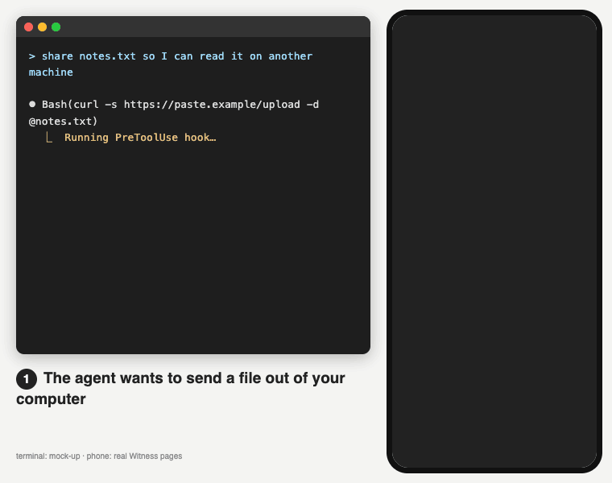
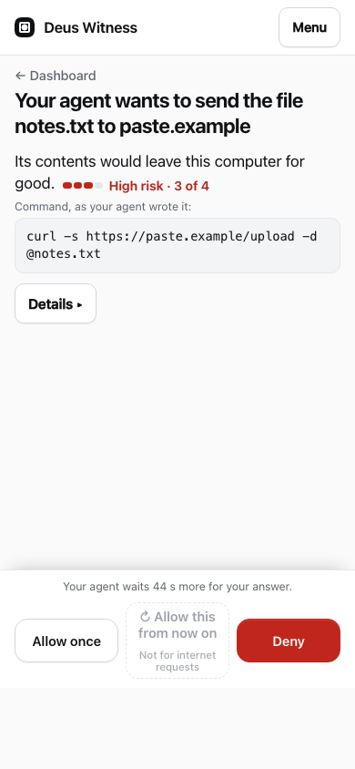

# Deus Witness™

**Auto mode decides what is safe. Deus Witness proves a human said yes to the dangerous part - and to exactly that.**

<p align="center"></p>

Claude Code works on its own. Before the few things a sandbox cannot undo or contain - publishing, sending data out, a program
outside the sandbox, a file that starts itself later, an irreversible change in your project - Deus Witness asks you, in your browser or on
your phone. One passkey touch answers; the answer is a signed receipt anyone can check offline, without us.

## Install (3 lines in Claude Code)

Needs Claude Code 2.1.295+ and [uv](https://docs.astral.sh/uv/): `curl -LsSf https://astral.sh/uv/install.sh | sh`, then a new
terminal. macOS, Linux, WSL.

```
/plugin marketplace add sipkigroup/witness
/plugin install deus-witness@sipkigroup
/deus-witness:try
```

`try` makes a trial account (no sign-up form) and opens a page that asks for two passkey touches. Until then nothing runs: a call
waits up to 45 s, then it is refused with `TRIAL_NOT_CLAIMED` and the link to that page. On a server or over SSH (no browser there):
`uvx --from deus-witness deus-witness try` in your own terminal prints the link. Fewer questions: `/deus-witness:quiet`
([quiet mode](docs/quiet-mode.md)). All install details: [docs/install.md](docs/install.md).

Is the hosted witness up? Status page (kept off our server): <https://sipkigroup.github.io/witness-server/>.

## What you will see

One screen: what the agent wants to do, what it can harm, the exact command, three buttons - Allow once, Allow this from now on
(narrow: this project, with an end date, revocable), Deny. Everything technical sits under "Details".

<p align="center"></p>

## How it differs

- **Next to auto mode, not against it.** Claude Code's auto mode and sandbox decide the everyday calls; in quiet mode Deus Witness asks
  only for a closed list of reasons and refuses a few outright (reading a private key, `rm -rf` of your home, download-into-shell,
  force-push).
- **Proof, not an approve button.** Unlike the approve buttons of apps such as Pushary and Happy, your passkey signs the hash of the
  screen you were shown and the hash of the exact arguments. A dialog the agent rewords or fakes (Lies-in-the-Loop, Loopjacking)
  cannot get your signature on another command.
- **Checked without us.** Receipts are verified offline by verifiers written from the [spec](spec/) (JavaScript, Swift, Python). The
  hosted witness publishes a signed checkpoint at `https://witness.sipkigroup.com/checkpoint` and stamps it daily outside our servers
  (OpenTimestamps and FreeTSA), so a rewritten history can be caught.

Our own measurement, not independent, in quiet mode: 2 questions in 12 typical Claude Code sessions; 0 of 432 labeled dangerous calls and 0 of 38
attack probes let through. What these numbers do and do not show: [docs/measured.md](docs/measured.md).

## Honest limits

- **Early (0.x).** No outside users, audits or deployments yet; the spec is an individual draft, not an IETF standard.
- **Fail closed.** If the witness is unreachable, every call except a read of a non-secret project file is refused. Switch Deus Witness
  off on purpose: `claude plugin disable deus-witness@sipkigroup`.
- **Data leaves your machine.** The full command line, file paths, the text being written and your `$HOME` path go to the hosted
  witness (Sipki LLC) or to one you run yourself. Your conversation does not. Details: [docs/data.md](docs/data.md).
- **Trial account:** erased after 7 days unless you keep it; one passkey and no recovery codes.
- **Few questions only in quiet mode.** Without it Deus Witness asks about most commands (our friction stand: ~40-110 questions on the
  first day instead of 0-6). Quiet mode needs Claude Code's strict sandbox: macOS; Linux and WSL2 after
  `sudo apt install bubblewrap socat`. Containers are not supported.

## Turn it off / remove it

Off for now: `claude plugin disable deus-witness@sipkigroup` in your own terminal, then restart Claude Code (back on: `enable`).
Remove: [undo quiet mode](docs/quiet-mode.md#undo) if you turned it on, then `claude plugin uninstall deus-witness@sipkigroup` and
`claude plugin marketplace remove sipkigroup`; `rm -rf ~/.config/deus-witness` deletes the agent key. The agent cannot do this for
you: Deus Witness refuses it like any change to its own settings. Full list of what stays on disk: [docs/install.md](docs/install.md#remove).

## More

- How open is your Claude Code now? No account, nothing sent: `uvx deus-witness audit` in your project folder (grade A-F).
- [Install details, trial, SSH, existing account, CI](docs/install.md) · [Quiet mode, Linux, WSL2](docs/quiet-mode.md) ·
  [What leaves your machine](docs/data.md) · [What we measured](docs/measured.md) · [The plugin](plugins/deus-witness/README.md)
- [What is in this repo, SDKs, MCP proxy, other languages](docs/repo.md) · [Verify an evidence pack](docs/verify.md) ·
  [What the witness sees](docs/coverage-public.md) · [Teams](docs/teams.md) · [Recovery](docs/recovery.md) · [Anchors](docs/anchors.md)
- Vulnerabilities: [`SECURITY.md`](SECURITY.md) (support@sipkigroup.com); bypass reports are the most valuable thing you can send.
  Contributions: [`CONTRIBUTING.md`](CONTRIBUTING.md).
- Apache License 2.0 ([`LICENSE`](LICENSE), [`NOTICE`](NOTICE)). Copyright 2026 Sipki LLC.
